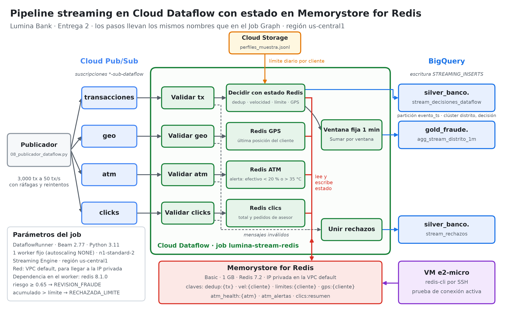

# Lumina Bank · Plataforma de datos en Google Cloud

Plataforma analítica para la fusión de 12 entidades financieras (caso DataBank Metropolitan → Lumina Bank): 9 millones de clientes, 8 distritos de Lima y transacciones en tiempo real.

- **Batch:** Cloud Storage → Apache Spark → BigQuery con arquitectura Medallion (Bronze, Silver, Gold) y esquema en estrella.
- **Streaming:** Pub/Sub → Cloud Dataflow (Apache Beam) con estado en Memorystore for Redis → BigQuery.
- **FinOps:** los servicios que cobran por hora se crean y eliminan con un solo comando.



**Equipo:** Enzo Ochoa, Luis Quispe y Roberto Mendez. Maestría en Ciencia de Datos, UTEC, curso de Big Data (2026).

## Estructura

```
lumina-bank-data-platform/
├── src/lumina/
│   ├── config.py                    Configuración central (variables de entorno / .env)
│   ├── pipeline.py                  Orquestador: Spark → SQL → streaming → consolidación
│   ├── ingesta/
│   │   ├── setup_infra.py           Buckets, tópicos, suscripciones y datasets
│   │   ├── generar_fuentes.py       Descarga SEC y Google Trends; genera las fuentes sintéticas
│   │   ├── cargar_lago.py           Sube los Parquet a Cloud Storage y publica eventos de muestra
│   │   └── carga_inicial_bigquery.py Carga inicial de Bronze y Silver
│   ├── batch/
│   │   ├── spark_cierres.py         Compuerta SHA-256, limpieza y cruces en Spark
│   │   ├── ejecutar_sql.py          Ejecuta el pipeline SQL paso a paso y registra cada job
│   │   └── sql/medallion.sql        24 pasos Bronze → Silver → Gold, calidad y conciliación
│   ├── streaming/
│   │   ├── dataflow_pipeline.py     Pipeline Apache Beam para Dataflow, estado en Redis
│   │   ├── publicador_dataflow.py   Prepara suscripciones y publica el tráfico de prueba
│   │   └── consumidor_local.py      Consumidor StreamingPull local (base de comparación)
│   └── ops/
│       └── reporte_dataflow.py      Junta la evidencia de un despliegue de Dataflow
├── infra/
│   ├── config.ps1                   Nombres, región y tamaños de los recursos efímeros
│   ├── desplegar_dataflow_memorystore.ps1
│   ├── apagar_y_verificar.ps1
│   ├── worker-requirements.txt      Dependencias que instala cada worker de Dataflow
│   └── redis_evidencia.sh           Consultas redis-cli de verificación (se ejecuta en la VM)
├── tests/                           Pruebas locales, sin costo (pytest + fakeredis)
├── reports/                         Evidencia JSON de las ejecuciones reales en GCP
├── docs/arquitectura/               Diagramas
├── .env.example                     Plantilla de configuración
├── pyproject.toml                   Paquete, dependencias, pytest y ruff
├── requirements.txt                 Entorno principal
├── requirements-spark.txt           Entorno de Spark (Java 17)
└── Makefile                         Atajos para Linux y macOS
```

## 1. Requisitos

| Herramienta | Versión | Para qué |
|---|---|---|
| Python | 3.11 (3.10 a 3.12) | Todo el código |
| Google Cloud CLI (`gcloud`) | reciente | Credenciales y scripts de `infra/` |
| Java | 17 | Solo para Spark |
| PowerShell | 5.1 o 7 | Solo para `infra/` (en Linux/macOS: `pwsh`) |
| Proyecto de GCP | con facturación habilitada | Dataflow y Memorystore no tienen capa gratuita |

## 2. Instalación

```powershell
git clone https://github.com/LuisQ95/lumina-bank-data-platform.git
cd lumina-bank-data-platform

python -m venv .venv
.venv\Scripts\activate            # Linux/macOS: source .venv/bin/activate
pip install -e ".[dataflow,dev]"   # o: pip install -r requirements.txt
```

Spark necesita Java 17, así que va en un entorno aparte:

```powershell
conda create -n lumina-spark -c conda-forge python=3.11 openjdk=17
conda activate lumina-spark
pip install -r requirements-spark.txt
pip install -e . --no-deps
```

## 3. Credenciales y configuración

```powershell
gcloud auth login
gcloud auth application-default login      # credenciales que usan las librerías de Python
gcloud config set project lumina-bank-utec-2026

gcloud services enable storage.googleapis.com pubsub.googleapis.com bigquery.googleapis.com `
    dataflow.googleapis.com compute.googleapis.com redis.googleapis.com

copy .env.example .env                     # Linux/macOS: cp .env.example .env
```

Edita `.env` si tu proyecto o región son distintos. Todas las variables están documentadas en [.env.example](.env.example); el código no tiene rutas ni proyectos escritos a mano.

La cuenta necesita estos roles: Storage Admin, Pub/Sub Editor, BigQuery Admin, Dataflow Admin, Cloud Memorystore Redis Admin y Compute Instance Admin. La cuenta de servicio por defecto de Compute Engine también necesita acceso de escritura a BigQuery y Cloud Storage, porque es la que usan los workers de Dataflow.

No subas llaves JSON al repositorio: `.gitignore` ya excluye `.env` y `*-key.json`.

## 4. Ejecución, en este orden

Todos los comandos se ejecutan desde la raíz del repositorio con el entorno activado.

### 4.1 Infraestructura y datos (una sola vez)

| Paso | Comando | Resultado | Costo |
|---|---|---|---|
| 1 | `python -m lumina.ingesta.setup_infra` | 2 buckets, 4 tópicos, 8 suscripciones, 5 datasets | Gratis |
| 2 | `python -m lumina.ingesta.generar_fuentes` | 11 fuentes Parquet en `data/` (unos 500 MB) | Gratis |
| 3 | `python -m lumina.ingesta.cargar_lago` | Parquet en Landing y Bronze, eventos de muestra en Pub/Sub | Capa gratuita |
| 4 | `python -m lumina.ingesta.carga_inicial_bigquery` | Tablas Bronze y Silver base (9 M clientes, 6.36 M transacciones) | Capa gratuita |

### 4.2 Pipelines de procesamiento

| Paso | Comando | Resultado | Reporte |
|---|---|---|---|
| 5 | `python -m lumina.batch.spark_cierres` *(entorno Spark)* | Compuerta SHA-256 con prueba negativa, cierres × tipo de cambio, transacciones × clientes | `reports/reporte_spark_p2.json` |
| 6 | `python -m lumina.batch.ejecutar_sql` | 24 pasos: tablas externas, Silver conformado, 4 tablas Gold, calidad y conciliación | `reports/reporte_pipeline_sql_p2.json` |
| 7 | `python -m lumina.streaming.consumidor_local --tx 3000 --tasa 50 --streams 8` | Decisiones en tiempo real en `silver_banco.stream_decisiones` | `reports/reporte_streaming_p2.json` |
| 8 | `python -m lumina.pipeline --solo-consolidar` | Consultas Gold, medición de partición y clustering, uso frente a cuotas | `reports/reporte_ejecucion_poc_p2.json` |

El orden importa: el SQL lee `silver_banco.cierres_fx_spark`, que produce Spark.

Para ejecutar los pasos 5 a 8 de una vez, define `LUMINA_SPARK_PYTHON` con el Python del entorno de Spark y ejecuta `python -m lumina.pipeline`.

Opciones útiles:

```powershell
python -m lumina.batch.ejecutar_sql --dry-run       # estima bytes sin ejecutar
python -m lumina.batch.ejecutar_sql --desde gold_   # retoma desde un paso
python -m lumina.batch.spark_cierres --sin-bigquery # Spark sin cargar a BigQuery
```

### 4.3 Streaming en Dataflow con Memorystore (cobra por hora)

Dataflow y Memorystore cuestan unos USD 0.31 por hora mientras existen. Se crean para la sesión y se eliminan al terminar; Cloud Storage, Pub/Sub y BigQuery se conservan.

| Paso | Comando | Qué hace |
|---|---|---|
| 9a | `.\infra\desplegar_dataflow_memorystore.ps1` | Solo verifica: credenciales, pruebas, armado del job (dry run) y recursos existentes. No crea nada |
| 9b | `.\infra\desplegar_dataflow_memorystore.ps1 -AceptoCosto` | Crea Memorystore (Basic 1 GB), una VM e2-micro para verificar y el job de Dataflow (1 worker). 15 a 25 minutos |
| 9c | `python -m lumina.streaming.publicador_dataflow --tx 3000 --tasa 50` | Publica 3,121 transacciones con ráfagas y reintentos duplicados |
| 9d | `python -m lumina.ops.reporte_dataflow` | Guarda la evidencia en `reports/reporte_dataflow_p2.json` |
| 9e | `.\infra\apagar_y_verificar.ps1` | Cancela el job, elimina Memorystore y la VM, y verifica que no quede nada cobrando |

Si el paso 9b falla, ejecuta 9e de inmediato para no seguir pagando.

## 5. Pruebas

```powershell
python -m pytest            # 17 pruebas locales, sin GCP ni costo
python -m ruff check src tests
```

- `tests/test_dataflow_pipeline.py`: reglas de decisión, deduplicación, ventanas por tiempo de evento y el grafo completo con Redis simulado (fakeredis).
- `tests/test_sql_medallion.py`: el SQL se divide en pasos únicos, Silver va antes que Gold y existen las cuatro tablas Gold.
- `tests/test_config.py`: la configuración se toma de variables de entorno.

## 6. Resultados medidos

La carpeta `reports/` guarda la evidencia de las ejecuciones reales en `lumina-bank-utec-2026`:

| Reporte | Resultado principal |
|---|---|
| `reporte_spark_p2.json` | Compuerta SHA-256 aprobada; la prueba negativa bloquea el lote alterado |
| `reporte_pipeline_sql_p2.json` | 24 jobs, conciliación con 0 diferencias en 15.36 M de filas |
| `reporte_streaming_p2.json` | 3,060 decisiones, latencia p50 278 ms y p99 962 ms (consumidor local) |
| `reporte_dataflow_p2.json` | Job de Dataflow con 3,060 decisiones, 61 duplicados filtrados en Redis, operaciones Redis p50 21 ms |
| `redis_cli_evidencia.txt` | Conexión activa a Memorystore desde la VM: 12,303 claves escritas por Dataflow |
| `reporte_diagnostico_pubsub.json` | Causa y solución de la latencia inicial de Pub/Sub (endpoint global y streams paralelos) |

## 7. Datos

SEC Financials y Google Trends provienen de datasets públicos de BigQuery. Las demás fuentes (transacciones con esquema PaySim, clientes, cierres, tipo de cambio EDI, GPS, cajeros y clics) son sintéticas y se generan con una semilla fija, por lo que la ejecución es reproducible. La carpeta `data/` no se sube al repositorio.

## 8. Problemas comunes

| Síntoma | Solución |
|---|---|
| `DefaultCredentialsError` | Ejecuta `gcloud auth application-default login` |
| Spark: `JAVA_HOME is not set` | Activa el entorno `lumina-spark`, que incluye Java 17 |
| `infra/*.ps1` no se ejecuta en Windows | `Set-ExecutionPolicy -Scope Process Bypass` |
| `gcloud` no se encuentra | Agrégalo al PATH o define `GCLOUD_BIN` en `.env` |
| La latencia del consumidor local es alta | Usa el endpoint global (ya configurado) y `--streams 8` |
